# OT Fabric IEC 61850 Explorer

[](https://github.com/otfabric/iec61850-explorer/actions/workflows/ci.yml)
[](LICENSE)

**Connect to an IEC 61850 IED, see the model it exposes, and read its values with their quality and time, without changing anything on the device.**

A cross-platform workbench for IEC 61850 over MMS, built by OT Fabric on [go-iec61850](https://github.com/otfabric/go-iec61850) and [go-mms](https://github.com/otfabric/go-mms). MIT licensed.

**Status: M4, trace analysis** (since v0.10.0; current release v0.13.2). Earlier milestones: the read-only browser (M1), inspection (M2a), Commission mode (M2b), comparison, semantics and point lists (M3). Release notes are in [RELEASE.md](RELEASE.md); what comes next (M5, the laboratory) is in [`docs/ARCHITECTURE.md`](docs/ARCHITECTURE.md), section 9.

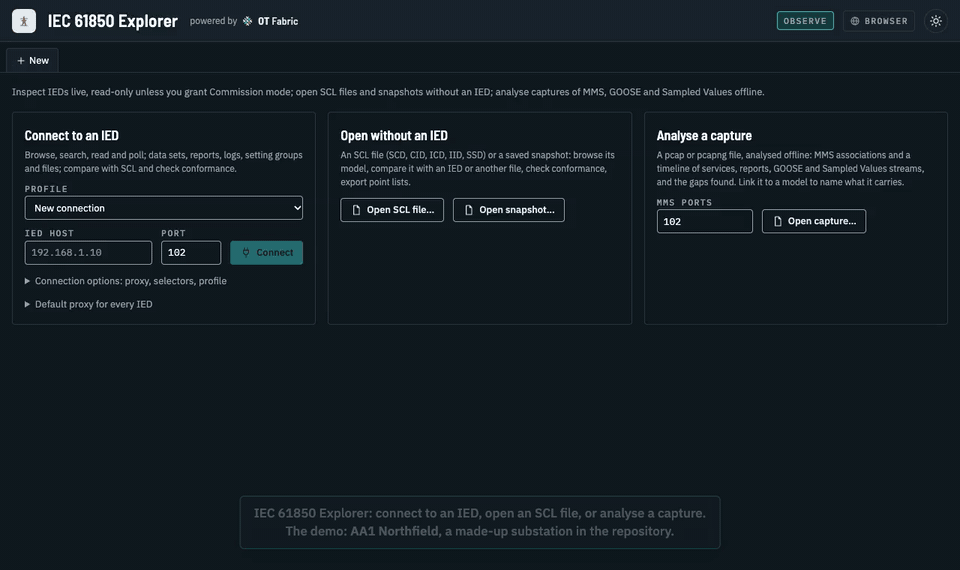

*The demo above is a highlight cut of under a minute. The full demo, three and a half minutes: [`docs/media/demo.mp4`](docs/media/demo.mp4), with captions in the picture and as an English subtitle track (also [`docs/media/demo.vtt`](docs/media/demo.vtt)). It runs through the [demo substation](demo/README.md): its SCD and CIDs, its live IEDs (`make demo-ieds`) and its captures. Step-by-step scenarios with screenshots are in [docs/PLAYBOOKS.md](docs/PLAYBOOKS.md).*

| | |
|---|---|
| 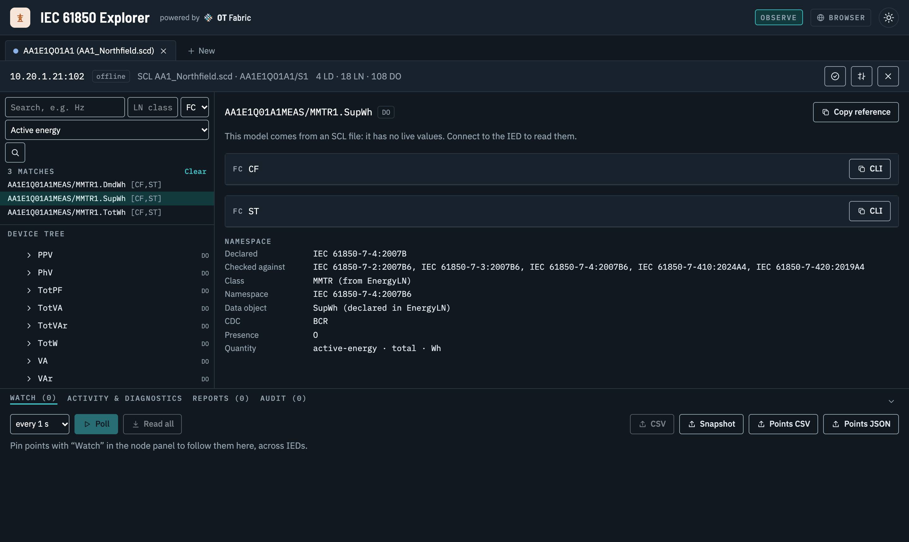 | 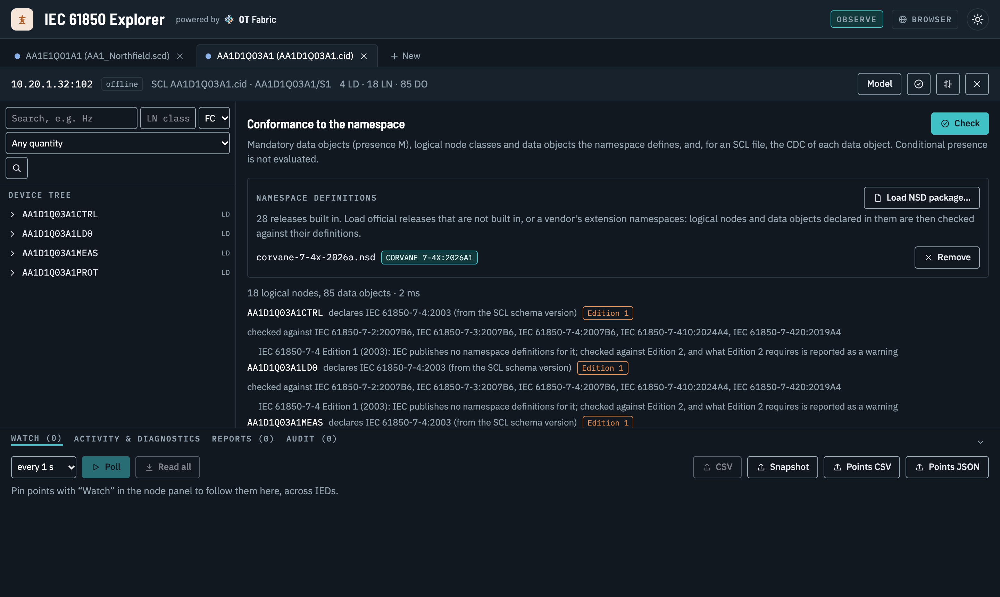 |
| **Offline, from SCL**: browse an IED of an SCD, search by quantity (here active energy), and see what the namespace defines for a data object: class, CDC, presence, quantity, unit. | **Conformance**: each logical device against the namespace it declares, Edition 1 files marked, vendor namespaces loaded as NSD packages. |
| 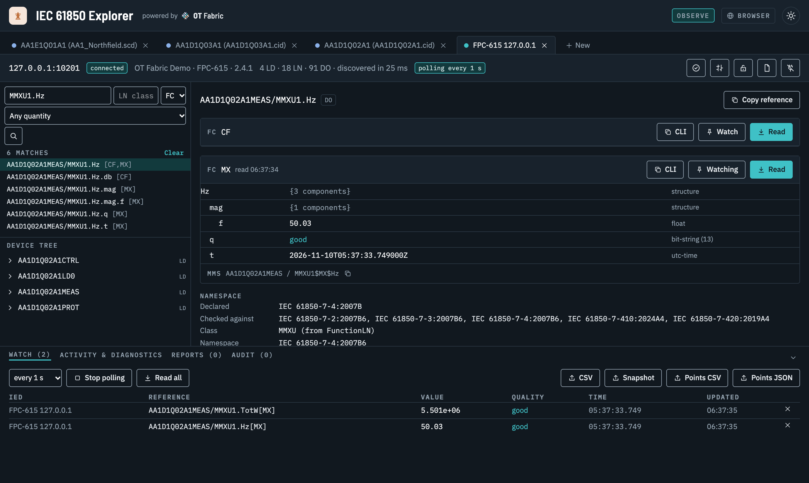 | 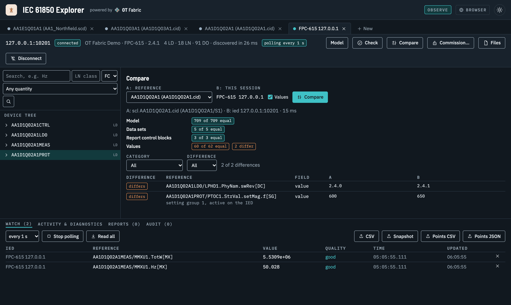 |
| **Live, in Observe mode**: read with quality, time and the MMS item; watch and poll points of several IEDs. | **Compare** an IED with its SCL file, values included: here a firmware update and a setting changed on the front panel. |
| 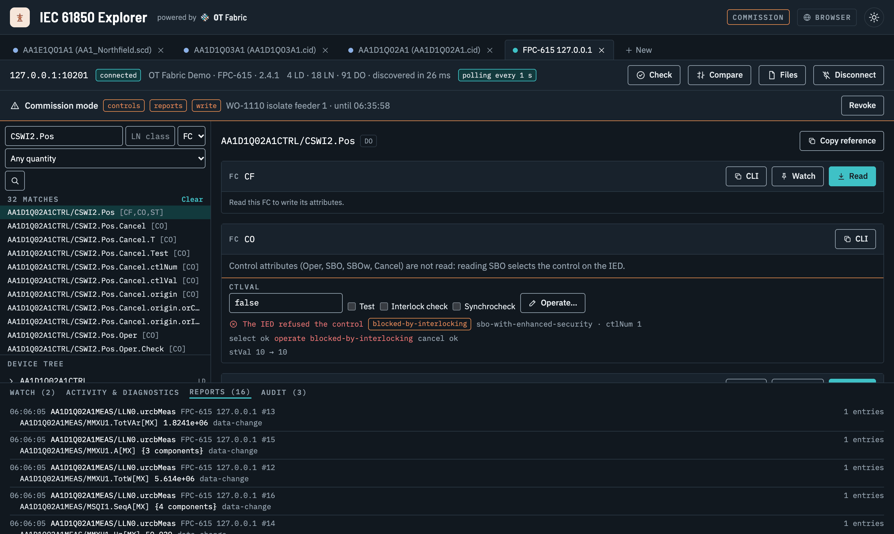 | 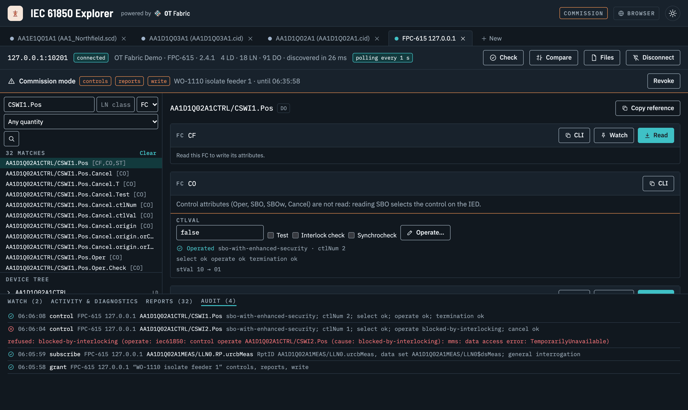 |
| **Commission mode**: operate controls with select, operate and CommandTermination shown; the IED's refusal and its reason. | **Audit trail**: the grant, report subscriptions and every control, with the reason given. |
| 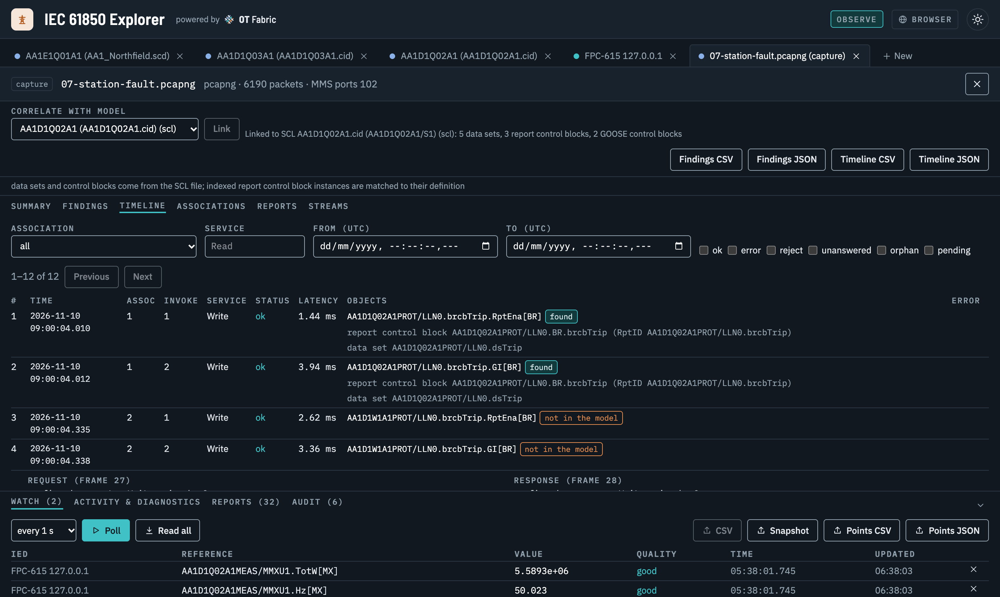 | 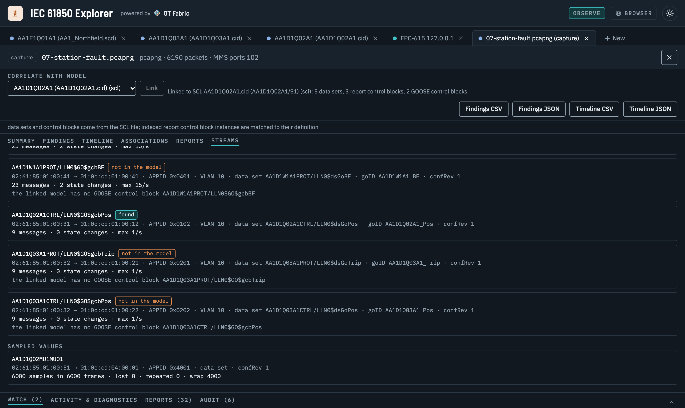 |
| **Captures**: the MMS timeline with status and latency, object names resolved against a linked model. | **GOOSE and Sampled Values** streams: messages, state changes, rates, lost and repeated samples. |
| 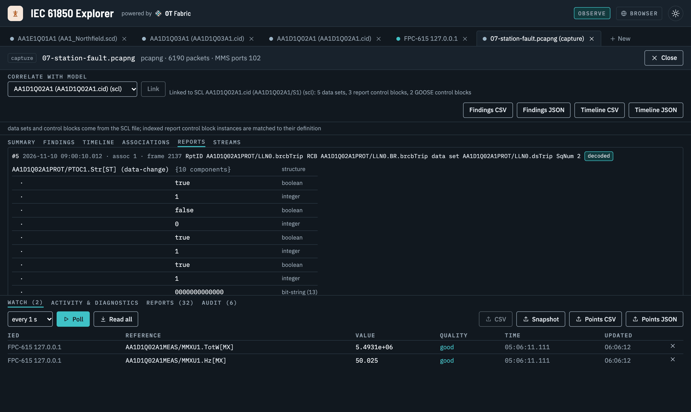 | 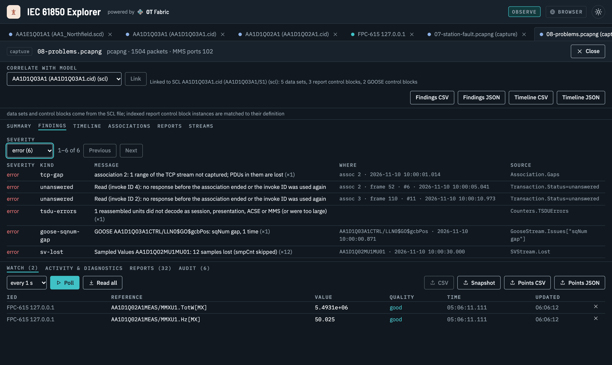 |
| **Reports** of a capture decoded against the linked model's data sets, with their reasons. | **Findings**: TCP gaps, unanswered requests, rejects, GOOSE and SV losses, each with where it is and its source. |

Also: the [start view](docs/images/start.png); a [vendor namespace not loaded](docs/images/conformance-vendor.png); [data sets](docs/images/datasets.png), [received reports](docs/images/reports.png) and the [IED's files](docs/images/files.png) with its COMTRADE record; a [light theme](docs/images/light.png).

## Two ways to run it

| | Desktop application | Daemon + browser |
|---|---|---|
| Program | `iec61850-explorer` (Windows, macOS, Linux) | `iec61850-explorerd` (static Linux binary: amd64, arm64, armv7; container image) |
| Use it when | The IED is on your network | The IED is reachable only from a gateway or an engineering host |
| How | Start the application | Run the daemon there, forward its port with SSH, open the URL it prints in a browser |

Both run the same engine and show the same interface. There is no "remote mode" in the desktop application.

## What it does

- **Connect** to an IED (host, port 102 by default) with the ISO addressing it expects: T/S/P selectors, AP-title and AE-qualifier, as in its SCL Address. Save connections as **profiles**. Reach IEDs **through a proxy** (SOCKS5 or HTTP CONNECT), per connection or by default.
- **Discover** its model (MMS Identify, then logical devices, logical nodes, data objects and attributes with their functional constraints) and **browse** it in a tree, or **search** it by reference, LN class (`MMXU`, `XCBR`, ...) and FC.
- **Read** a node under one of its functional constraints. Structures show their component names; a quality is decoded (`good`, `questionable (old-data)`, ...); a timestamp shows its time quality. Every value shows the MMS domain and item ID it was read from, and the equivalent `iec61850ctl get object` command can be copied.
- **Watch** points from several IEDs in one table and **poll** them (0.5 s to 1 min); the engine polls, so a daemon keeps polling while the browser is away.
- **Open an SCL file** (SCD, CID, ICD, IID): browse an IED's data model offline, or fill in the connection with the address the file gives it.
- **Inspect** what a logical device defines: data sets (read in one request, or pinned to the watch table), report control blocks with their configuration, logs by time range, setting groups; and the IED's **files** (download disturbance records). From an SCL file, data sets and report control blocks are shown as the file defines them.
- **Export** a snapshot (the model and the watched values, JSON) or the watched values as CSV; **open a snapshot** again later, without the IED.
- **See what happened on the wire**: every action (connect, discover, read, close) is logged with its duration and the MMS requests it sent. A failed connect says where it stopped (TCP, COTP, session, presentation, ACSE or MMS Initiate) when the error proves it, and what to check.
- **Observe mode** by default: the MMS client is built so that it cannot send a Write, a control, a report or data set change, or a file change. See [SECURITY.md](SECURITY.md).
- **Commission mode** on request, per session: a grant with a reason and a duration opens a second, restricted association. **Write** set points and configuration values (FC SP, CF, DC, SV, BL), each verified by reading it back; **subscribe** to report control blocks and watch the reports arrive (the control block is released again when you stop); **create and delete** data sets; **switch** the active setting group; **operate controls** of every control model, with the select, the operate, the CommandTermination and the IED's reasons shown. Everything is recorded in an audit trail. The daemon offers it only with `--allow-commission`.

- **Compare** two sessions (IED, SCL file, snapshot): model, data sets, report control blocks and configured values; **check conformance** against the IEC 61850 namespaces; export **point lists**.
- **Analyse a capture** (pcap or pcapng, plain or gzip, at most 256 MiB) offline, with [go-mms-trace](https://github.com/otfabric/go-mms-trace): the MMS associations, a **timeline** of the confirmed services with their status (ok, error, reject, unanswered, orphan, pending) and latency, the reports, the GOOSE and Sampled Values streams, and the **findings**: TCP gaps, unanswered and failed requests, associations captured midstream or still open, decoding errors, lost or repeated GOOSE and SV messages, each with where it is and the counter it comes from. MMS on another port than 102 (1102 in iec61850-interop captures) is analysed when the port is named. **Link** the capture to an IED, SCL or snapshot session: object names become IEC 61850 references, are looked up in that model, and reports are decoded against their data sets; what the model does not have is a finding. Findings and the timeline export as CSV and JSON.
- **The wire view** of every action on an IED: the MMS PDUs it sent and received, decoded, and their bytes, in the activity panel.

Not yet: editing setting values, time-activated controls, live capture, MMS over TLS in captures.

## Build from source

```bash
make build
```

This builds `bin/iec61850-explorer` (needs a C compiler and the platform's webview; see [CONTRIBUTING.md](CONTRIBUTING.md)) and `bin/iec61850-explorerd`. It needs Go and Node.js 22 or later; the frontend dependencies are installed (`npm ci`) on the first build and again when `frontend/package-lock.json` changes.

## Try it without hardware

`iec61850ctl` serves an IED from an SCL file:

```bash
iec61850ctl server start --scl device.cid --host 127.0.0.1 --port 10102
```

Then start the desktop application (`make dev`) and connect to `127.0.0.1`, port `10102`. With the daemon, allow the loopback target:

```bash
bin/iec61850-explorerd --allow-target 127.0.0.1
```

and open the URL that `bin/iec61850-explorerd url` prints.

The [demo set](demo/README.md) is a whole (made-up) 110/20 kV substation to try every view with: an SCD and five CIDs (one of them Edition 1, one with a vendor namespace), packet captures of MMS, GOOSE and Sampled Values (discovery, reports, controls, settings, files and logs, a fault, and a capture full of problems), and its five IEDs served live by `make demo-ieds` on 127.0.0.1:10201 to 10205.

## Remote use

On the gateway:

```bash
iec61850-explorerd
```

On the workstation, forward the port and open the URL that `iec61850-explorerd url` prints on the gateway (the part after `#` is the access token: treat the URL like a password):

```bash
ssh -N -L 8765:127.0.0.1:8765 user@gateway
```

The daemon listens on loopback, requires its token even there, checks the Host header and connects only to private and link-local addresses unless `--allow-target` says otherwise. `iec61850-explorerd token rotate` replaces the token. More in [docs/REMOTE-USE.md](docs/REMOTE-USE.md); a systemd unit is in [`packaging/`](packaging/).

## Connecting through a proxy

When the IEDs are reachable only through a jump host or a gateway proxy, the Explorer connects through a SOCKS5 proxy or an HTTP proxy's CONNECT method:

- `socks5://[user:password@]host[:1080]`: the Explorer resolves the IED's host name and sends the address; when the name has several addresses, each is tried in turn until the proxy reaches one.
- `socks5h://[user:password@]host[:1080]`: the proxy resolves the IED's host name.
- `http://[user:password@]host[:8080]`: HTTP CONNECT, with `Proxy-Authorization: Basic` when a user is given; the proxy resolves the name.

The **Proxy** field of the connection form (and of a profile) sets the proxy of one IED; empty uses the **default proxy**, `direct` connects without a proxy even when a default is set. The default proxy is set below the connection form; the desktop application keeps it in its data directory (`settings.json`, mode 0600). A session shows the proxy it connected through, always with the password replaced (`xxxxx`): in the session bar, the API, the logs, events and snapshots. A failed connection through a proxy is reported at the stage `proxy`: the proxy not reachable, a malformed answer, authentication refused, or the proxy refusing the IED (with the SOCKS reply code or the HTTP status).

The daemon takes its default proxy from `--proxy URL` (or `--proxy direct`), else from the environment variable `ALL_PROXY` or `all_proxy`; it logs the one in use at start, without its password. A default the operator sets this way cannot be changed through the API, and the web UI shows it read-only. Without one, users of the daemon may set a default. The target allow-list still applies; see [SECURITY.md](SECURITY.md).

```bash
iec61850-explorerd --proxy socks5://127.0.0.1:1080   # for example the end of "ssh -D 1080 jump-host"
```

A password in a proxy URL is stored as given in a profile or the settings file (both mode 0600 in the data directory); use a proxy account for the purpose.

## Documentation

- [Architecture](docs/ARCHITECTURE.md): layering, the `Service` interface, the HTTP API, Observe mode, the capability audit of the libraries, milestones
- [Playbooks](docs/PLAYBOOKS.md): task-oriented scenarios with screenshots, on the demo substation
- [Decisions](docs/adr/)
- [Security](SECURITY.md), [Testing](TESTING.md), [Contributing](CONTRIBUTING.md)

## How the media are made

The screenshots, the demo video and its subtitles are made by [`docs/media/record-demo.mjs`](docs/media/record-demo.mjs) (Playwright in the local Chrome, ffmpeg) against the daemon's web UI and `make demo-ieds`; usage is in its header. Rerun it when the user interface changes visibly. The captions are written once in the script: drawn into the video's frames and written as WebVTT from the same cue list, with the times of the recorded frames.

## License

MIT, see [LICENSE](LICENSE).
