# Playbooks

Task-oriented walkthroughs of the IEC 61850 Explorer. Each one says what it is for, what you need, the steps with the labels the user interface shows, what you should see, and the pitfalls.

They all work on the [demo substation](../demo/README.md) AA1 Northfield, a made-up 110/20 kV station that comes with the repository: an SCD, a CID per IED, a vendor namespace, eight captures and five IEDs served live by `make demo-ieds` on 127.0.0.1:10201 to 10205. The steps are the same with your own files and IEDs. The screenshots are of the daemon's web UI (`iec61850-explorerd`); the desktop application shows the same interface.

To follow along with the daemon:

```bash
make build-daemon
make demo-ieds                                                    # terminal 1: feeder 1 on :10201, feeder 2 on :10202, ...
bin/iec61850-explorerd --allow-target 127.0.0.1 --allow-commission   # terminal 2
bin/iec61850-explorerd url                                        # open this URL; the part after # is the access token
```

`--allow-commission` is needed only for playbook 5. With the desktop application (`make dev`), nothing else is needed.

| # | Playbook | Needs |
|---|---|---|
| 1 | [Inspect an SCL file offline and find points by quantity](#1-inspect-an-scl-file-offline-and-find-points-by-quantity) | `demo/scl/AA1_Northfield.scd` |
| 2 | [Check conformance: Edition 1 and vendor namespaces](#2-check-conformance-edition-1-and-vendor-namespaces) | the SCD, `demo/scl/AA1D1Q03A1.cid`, `demo/nsd/corvane-7-4x-2026a.nsd` |
| 3 | [Commission a live IED: read, watch, data sets, reports, setting groups, files](#3-commission-a-live-ied-read-watch-data-sets-reports-setting-groups-files) | feeder 1 live on 127.0.0.1:10201 |
| 4 | [Verify an IED against its SCL](#4-verify-an-ied-against-its-scl) | feeder 1 live, `demo/scl/AA1D1Q02A1.cid` |
| 5 | [Operate a breaker safely in Commission mode](#5-operate-a-breaker-safely-in-commission-mode) | feeder 1 live, a daemon with `--allow-commission` |
| 6 | [Analyse a station capture and link it to the model](#6-analyse-a-station-capture-and-link-it-to-the-model) | `demo/captures/07-station-fault.pcapng`, feeder 1's CID |
| 7 | [Find what went wrong in a capture](#7-find-what-went-wrong-in-a-capture) | `demo/captures/08-problems.pcapng`, feeder 2's CID |
| 8 | [Export a point list for SCADA or gateway engineering](#8-export-a-point-list-for-scada-or-gateway-engineering) | any SCL file or live IED |

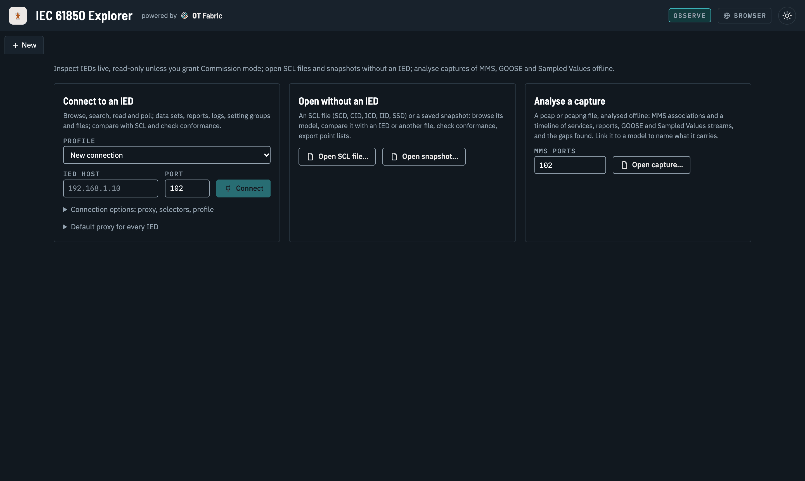

---

## 1. Inspect an SCL file offline and find points by quantity

**Goal:** see what an IED's data model holds before you have the IED, and find the data objects that measure a quantity (frequency, voltage, current, active, reactive and apparent power, power factor, the three energies, impedance) without knowing the logical node classes by heart.

**You need:** an SCD, CID, ICD or IID. Here `demo/scl/AA1_Northfield.scd`.

1. On the start view, under **Open without an IED**, choose **Open SCL file…** and pick the file.
2. The dialog lists the file's IEDs with manufacturer, type, number of logical devices and IP address. For the transformer protection `AA1E1Q01A1`, choose **Browse offline**. (**Use address** instead fills in the connection form with the IED's address and ISO selectors.)
3. The **Device tree** shows the logical devices (`AA1E1Q01A1CTRL`, `LD0`, `MEAS`, `PROT`). Expand them to logical nodes, data objects and attributes; select a node to see its functional constraints.
4. In the search box above the tree, pick a quantity in the list that reads **Any quantity**, for example `impedance`, and press the search button. Combine it with text (**Search references**), an **LN class** and an **FC** if you like.
5. Pick a match. Below its functional constraints, the **Namespace** section says what the IEC 61850 namespace defines for it: the namespace declared, the releases it was checked against, the class, the data object, its CDC, presence, and the quantity with its phase and unit.

**You should see:** `impedance` finds `MMXU1.Z` and `MMXU2.Z`; `active-energy` finds the meter's `MMTR1.TotWh`, `SupWh` and `DmdWh` (`BCR`, presence `O`, `active-energy · total · Wh`). Selecting a logical node lists the data objects of its class and which ones this node has, with mandatory ones it lacks marked `missing`.

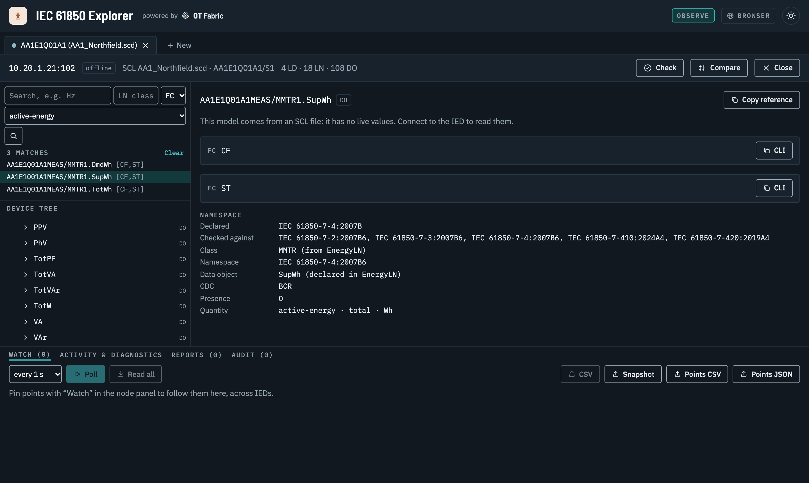

**Pitfalls:**

- An SCL session has no values. The node panel says so; connect to the IED (playbook 3) to read them. From an SCL file, data sets and report control blocks are shown as the file defines them; logs and setting groups need the IED.
- The search looks at the model of the open tab only. A quantity comes from the namespace's rules, not from names: a vendor data object that the namespace does not define is not found by quantity.
- An SCD can hold an IED without an MMS access point (a merging unit, for example): the dialog then has nothing to browse for it.

---

## 2. Check conformance: Edition 1 and vendor namespaces

**Goal:** check a model against the IEC 61850 namespaces: mandatory data objects that are missing, logical node classes and data objects the namespace does not define, and (for an SCL file) CDCs that differ from the namespace's.

**You need:** a model (SCL session, snapshot or live IED). Here the transformer from the SCD (playbook 1), `demo/scl/AA1D1Q03A1.cid` (feeder 2, an Edition 1 file) and the vendor's namespace package `demo/nsd/corvane-7-4x-2026a.nsd`.

1. In the tab of the transformer's SCL session, choose **Check** in the session bar, then **Check** in the panel **Conformance to the namespace**.
2. Read the list of declared namespaces: for each logical device (and each logical node that declares its own) what it declares, where that comes from (`ldNs`, `lnNs` or the SCL schema version) and the releases it was checked against.
3. `AA1E1Q01A1CTRL/YLTC1` declares `CORVANE 7-4X:2026A`, marked **not loaded**: the namespace is neither built in nor loaded, so the node was checked against the default profile and its vendor data objects are findings.
4. Under **Namespace definitions**, choose **Load NSD package…** and pick `corvane-7-4x-2026a.nsd` (an NSD file or a ZIP of them). The package appears with the namespace it defines. Choose **Check** again: the vendor data objects `MotDrvTmp` and `MotDrvA` are now checked against their definitions and are no longer findings.
5. Open feeder 2's CID: **+ New**, **Open SCL file…**, `AA1D1Q03A1.cid`, **Browse offline** for `AA1D1Q03A1`. **Check**, then **Check**.

**You should see:** for the Edition 1 file, every logical device "declares IEC 61850-7-4:2003 (from the SCL schema version)" with an **Edition 1** chip, and the note that IEC publishes no namespace definitions for Edition 1: the model is checked against Edition 2, and what Edition 2 requires is reported as a warning. Filter the findings with **Severity**.

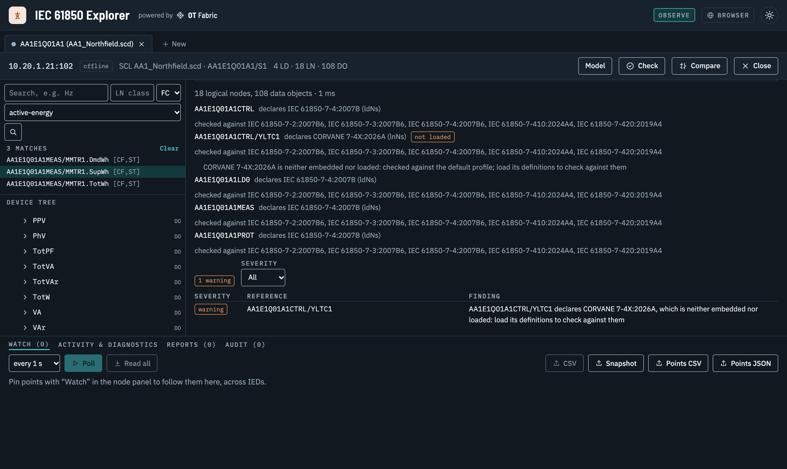

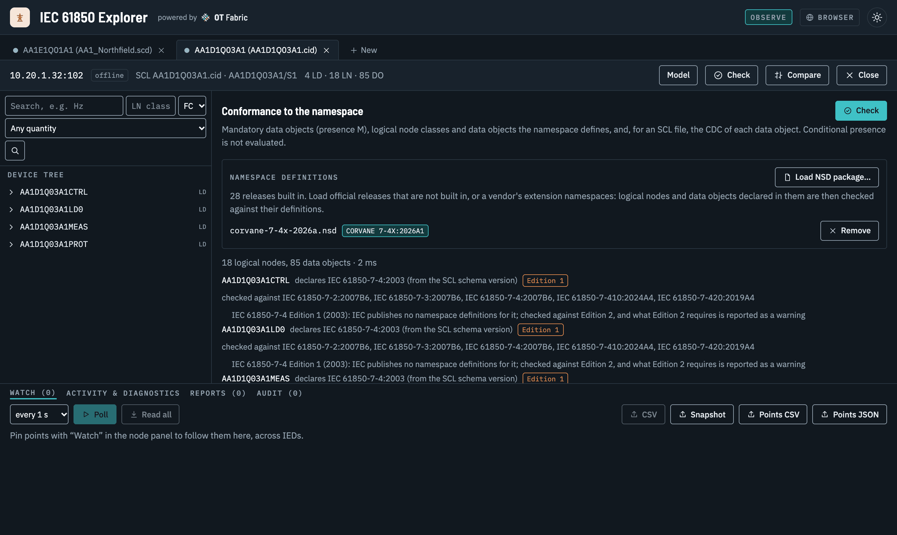

**Pitfalls:**

- Conditional presence is not evaluated; only presence M is a mandatory finding.
- Loaded packages belong to the engine (the desktop application or the daemon), not to one session: they apply to every check until you **Remove** them.
- Live, an IED does not say which edition its configuration was written for: feeder 2 on 127.0.0.1:10202 is checked with the default profile, not as Edition 1. Check the CID for that.
- In the SCD, feeder 2 is an IED of an Edition 2 file without namespace declarations; it is not marked Edition 1 there.

---

## 3. Commission a live IED: read, watch, data sets, reports, setting groups, files

**Goal:** connect to an IED during commissioning or fault finding and see its values, data sets, report control blocks, logs, setting groups and files, without changing anything on it.

**You need:** the IED's address. Here feeder 1, `AA1D1Q02A1`, on 127.0.0.1 port 10201 (`make demo-ieds`). With the daemon, the address must be in its allow-list (`--allow-target`).

1. **+ New**, then under **Connect to an IED** enter **IED host** `127.0.0.1` and **Port** `10201`, and choose **Connect**. (ISO selectors, a proxy and saving the connection as a profile are under **Connection options**.) The session starts in **Observe** mode (the badge at the top right): the MMS client refuses every service that would change the IED, before it is sent.
2. The session bar shows the address, `connected`, the MMS identity (`OT Fabric Demo · FPC-615 · 2.4.1`) and what discovery found (4 LD · 18 LN · 91 DO).
3. Search for `MMXU1.TotW` and pick the match. In the **FC MX** block choose **Read**: the value with its quality and time stamp, and below it the MMS domain and item ID it was read from. **CLI** copies the equivalent `iec61850ctl get object` command.
4. Choose **Watch** to pin it; do the same for `MMXU1.Hz`. In the dock below, **Watch** lists the points of every open IED; pick an interval (**every 1 s**) and choose **Poll**. The engine polls, so a daemon keeps polling while the browser is closed. **Stop polling** ends it.
5. Select the logical device `AA1D1Q02A1MEAS` in the tree. The panel has the tabs **Data sets**, **Report control blocks**, **Logs** and **Setting groups**. On `dsMeas` choose **Read** to read all members in one request, or **Watch all**.
6. **Report control blocks** shows each RCB's configuration as read: RptID, DatSet, ConfRev, TrgOps, OptFlds, BufTm, IntgPd, RptEna, reservation, SqNum, owner.
7. Select `AA1D1Q02A1PROT`, tab **Setting groups**: two groups, group 1 active.
8. Select `AA1D1Q02A1CTRL`, tab **Logs**: pick the **Log** (`EventLog`) and a **Time range**, then **Read log**.
9. Choose **Files** in the session bar: the IED's file store, here its CID and the COMTRADE record of the 09:00:10 fault (`.cfg`, `.dat`). **Download** saves a file through the browser.
10. **Activity & diagnostics** in the dock lists every action with its duration and the MMS requests it sent; open one to see its MMS units, decoded, and their bytes.

**You should see:**

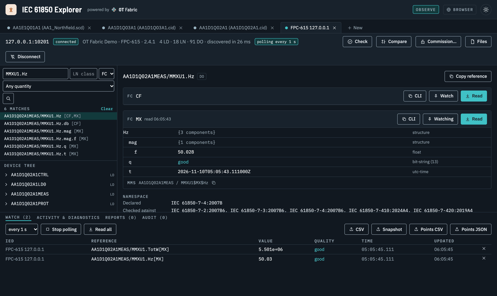

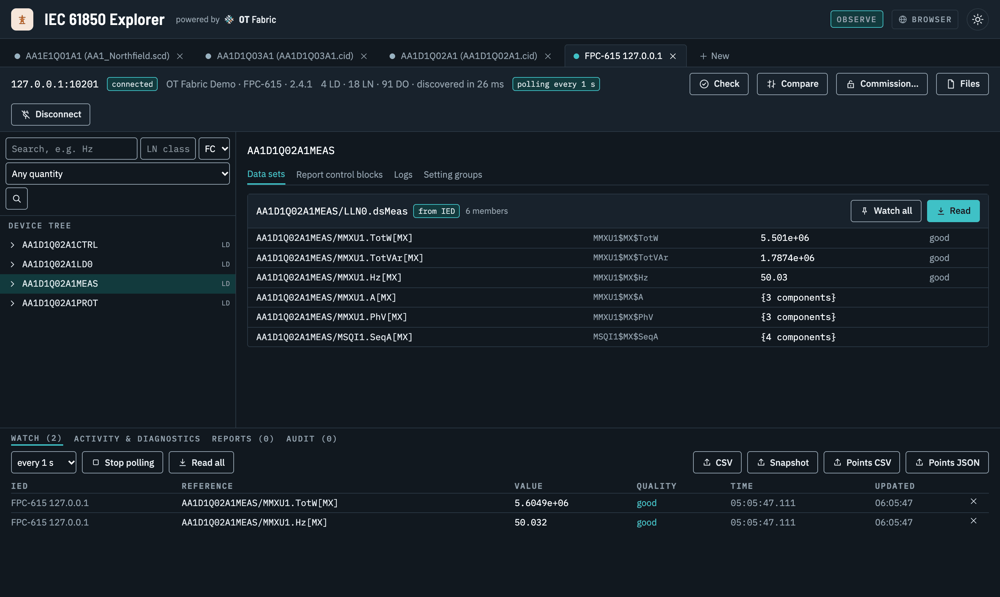

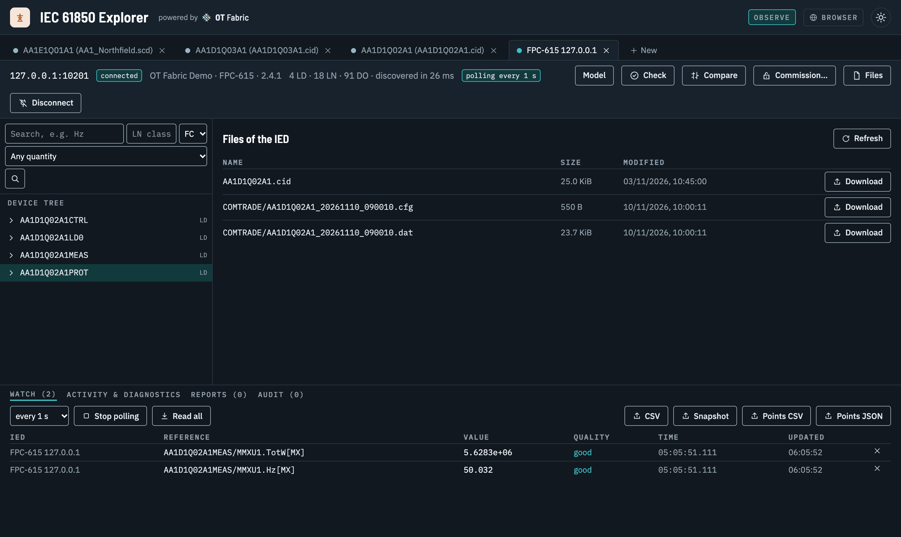

**Pitfalls:**

- Reading never selects a control: the FC **CO** block is not read (reading SBO would select the control on the IED). Operating needs playbook 5.
- A report control block that shows "enabled: another client may own it" is in use by someone else (the station HMI, a gateway). Do not take it over during operation.
- If the connection fails, the error says at which stage it stopped (TCP, COTP, session, presentation, ACSE, MMS Initiate, or the proxy) when the error proves it, and what to check. Wrong selectors usually fail at the session or ACSE stage: take them from the SCL (**Use address**).
- With the daemon, an address outside `--allow-target` is refused before anything is sent.

---

## 4. Verify an IED against its SCL

**Goal:** prove that the IED runs the configuration you have on file: its model, data sets, report control blocks, and the configured values (FC CF, DC, SP and SG, settings per group).

**You need:** a live session and the SCL file (or a snapshot) to compare it with. Here feeder 1 on 127.0.0.1:10201 and `demo/scl/AA1D1Q02A1.cid`.

1. Open the CID: **+ New**, **Open SCL file…**, `AA1D1Q02A1.cid`, **Browse offline** for `AA1D1Q02A1`.
2. Connect to the IED (playbook 3) and stay in its tab.
3. Choose **Compare** in the session bar. **A: reference** is the CID session; **B: this session** is the IED. Turn on **Values** to compare configured values too (this reads them from the IED). Choose **Compare**.
4. The summary gives, per category (**Model**, **Data sets**, **Report control blocks**, **Values**), how many items are equal, only in A, only in B, or differ. Filter the table with **Category** and **Difference**.

**You should see:** the model (709 items), the 5 data sets and the 3 report control blocks equal, and exactly two values that differ: `AA1D1Q02A1LD0/LPHD1.PhyNam.swRev[DC]` (2.4.0 in the CID, 2.4.1 on the IED: someone updated the firmware) and `AA1D1Q02A1PROT/PTOC1.StrVal.setMag.f[SG]` (600 in the CID, 650 on the IED, "setting group 1, active on the IED": someone changed I> on the front panel).

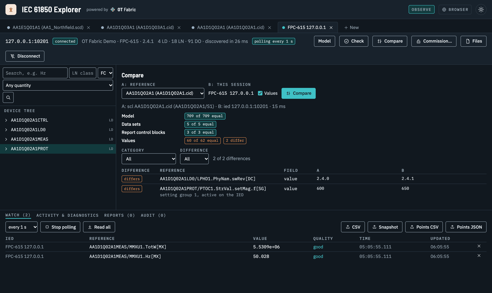

**Pitfalls:**

- Any two open sessions can be compared: two IEDs, an IED and a snapshot taken last year, two SCL files. Close what you do not need: the daemon allows 8 open sessions by default (`--max-sessions`).
- Without **Values** only the structure is compared; a changed setting is then not a difference.
- Settings are compared per setting group; an IED that has another group active than the SCL says is a difference in itself.
- `cd demo && go run ./ieds -exact` serves feeder 1 as its CID says: then there are no differences.

---

## 5. Operate a breaker safely in Commission mode

**Goal:** operate a control (here: isolate feeder 1, opening breaker QA1 and disconnector QB1) with every step visible and recorded, and see the IED refuse what its interlocking forbids.

**You need:** a live session and Commission mode: the desktop application, or a daemon started with `--allow-commission`. Feeder 1's QA1 (`CTRL/CSWI1.Pos`) and QB1 (`CTRL/CSWI2.Pos`) are SBO with enhanced security; QB1 is interlocked and refuses to open while QA1 is closed.

1. In the IED's tab, choose **Commission…** in the session bar.
2. In the **Commission mode** dialog, give a **Reason** (it is recorded, for example a work order), a **Duration in minutes**, and the **Capabilities** you need: here **Operate controls** (and **Subscribe to report control blocks** to watch the reports). Choose **Grant**. The header badge changes from **observe** to **commission**, and a banner shows the capabilities, the reason and when the grant ends. Changes go over a second association that allows only what was granted.
3. Optional: select `AA1D1Q02A1MEAS`, tab **Report control blocks**, choose **Subscribe** on `urcbMeas` (with **General interrogation on subscribe**). The **Reports** tab of the dock shows the reports as they arrive, with each entry's reason (data-change, integrity, GI).
4. Search `CSWI2.Pos` and pick `AA1D1Q02A1CTRL/CSWI2.Pos`. In the **FC CO** block set **ctlVal** to `false` (open), choose **Operate…**, read the confirmation and choose **Operate**.
5. The IED refuses: "The IED refused the control", `blocked-by-interlocking`, with the steps `select ok`, `operate blocked-by-interlocking`, `cancel ok`.
6. Pick `AA1D1Q02A1CTRL/CSWI1.Pos` (breaker QA1), **ctlVal** `false`, **Operate…**, **Operate**: "Operated", `select ok`, `operate ok`, `termination ok`, and the position before and after.
7. Operate QB1 again: now it opens.
8. The **Audit** tab lists the grant, the subscription and each control with its outcome and the IED's reason. Choose **Revoke** in the banner when you are done: the grant ends, subscriptions are released, the second association is closed.

**You should see:**

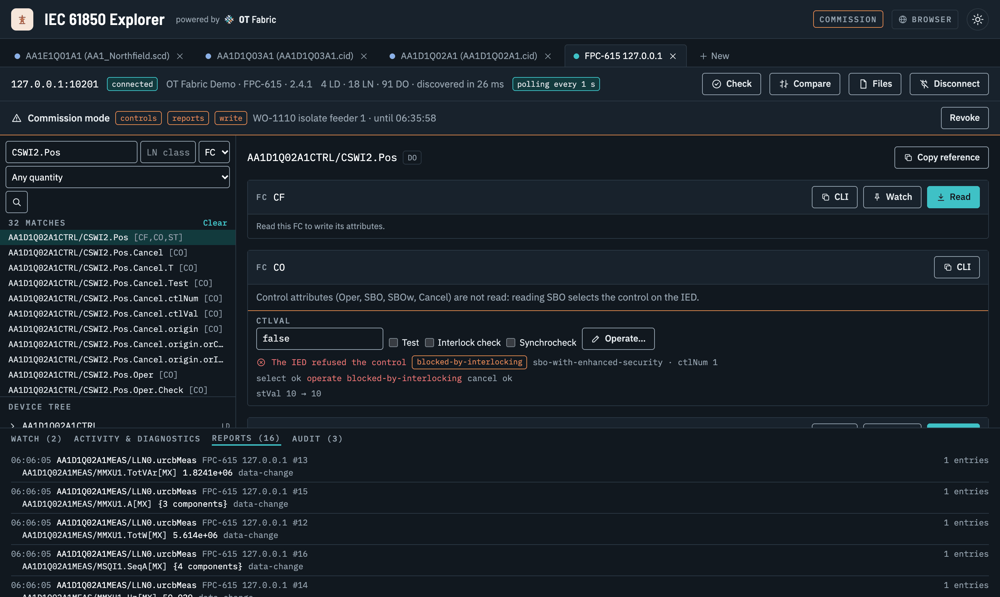

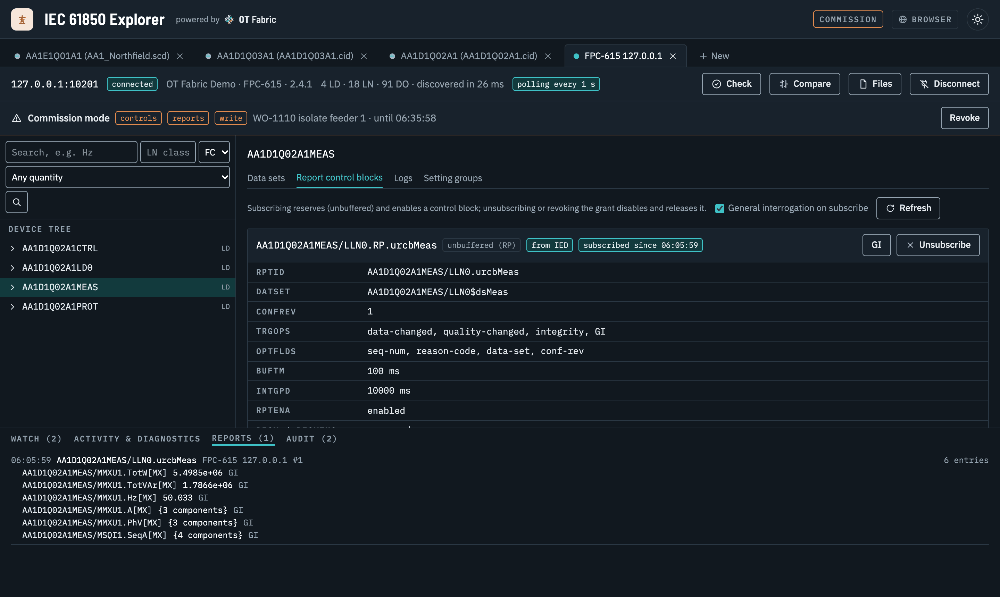

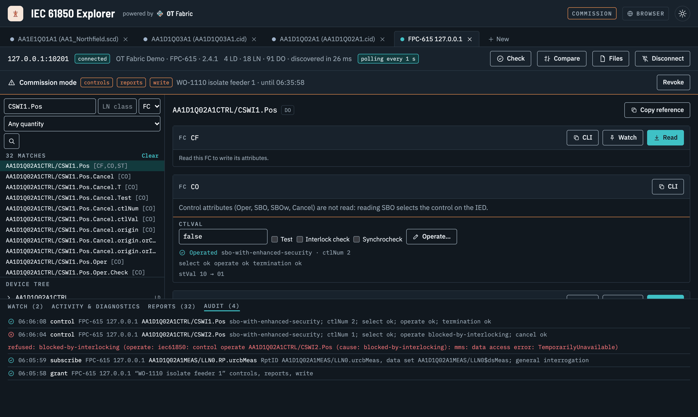

**Pitfalls:**

- The position is shown as the Dbpos bit string: `10` is on (closed), `01` is off (open).
- **Interlock check** and **Synchrocheck** set the Check bits of the command; they ask the IED to check, they do not check anything in the Explorer.
- The grant ends when it expires, when you revoke it and when the session ends; a report control block you subscribed to is disabled and released then. Ask for the shortest duration that does the job.
- Restart `make demo-ieds` to close QA1 again (the demo IEDs keep their state while they run). Closing QA1 with QB1 open is refused too.

---

## 6. Analyse a station capture and link it to the model

**Goal:** understand a fault from a capture of the station bus: the MMS services, the reports, the GOOSE and Sampled Values streams, with MMS names resolved to IEC 61850 references.

**You need:** a pcap or pcapng (plain or gzip, at most 256 MiB) and the model of an IED in it. Here `demo/captures/07-station-fault.pcapng` (the fault at 09:00:10 on feeder 1, its breaker failing to open, the busbar protection's breaker failure, the transformer clearing it) and feeder 1's CID, open as in playbook 4.

1. **+ New**. Under **Analyse a capture**, leave **MMS ports** at `102` (name other ports, comma separated, when MMS runs elsewhere) and choose **Open capture…**.
2. **summary**: the file (format, packets, time span, SHA-256), the content (3 associations, 12 transactions, 19 reports, 6 GOOSE streams, 1 SV stream), counts by status and service, findings and the decoder's counters.
3. **Correlate with model**: pick `AA1D1Q02A1 (AA1D1Q02A1.cid) (scl)` and choose **Link**. The line next to it says what the model offers (data sets, report control blocks, GOOSE control blocks).
4. **timeline**: every confirmed service with time, association, invoke ID, service, status, latency and the objects it named, resolved against the model (`found`, `not in the model`). Filter by **Association**, **Service**, **From (UTC)**, **To (UTC)** and status. Select a row to see the request and the response, decoded.
5. **reports**: each captured InformationReport with its RptID, control block, data set and SqNum. Reports of feeder 1 are `decoded` against `dsTrip`: the entries `PTOC1.Str`, `PTOC2.Str`, `PTOC2.Op` and `PTRC1.Tr`, each with its reason for inclusion (`data-change`) and its value.
6. **streams**: the GOOSE streams with source and destination, APPID, VLAN, data set, goID, messages, state changes and the highest rate; the SV stream with samples, lost and repeated.
7. **associations**: client, server, how each association opened and closed, transactions, unanswered requests and TCP gaps.

**You should see:** feeder 1's `gcbTrip` and the busbar protection's `gcbBF` with 23 messages and 2 state changes each (the trip and its reset, 152 ms apart), `found` for feeder 1's own GoCBs, and the merging unit's stream `AA1D1Q02MU1MU01` with 6000 samples, none lost.

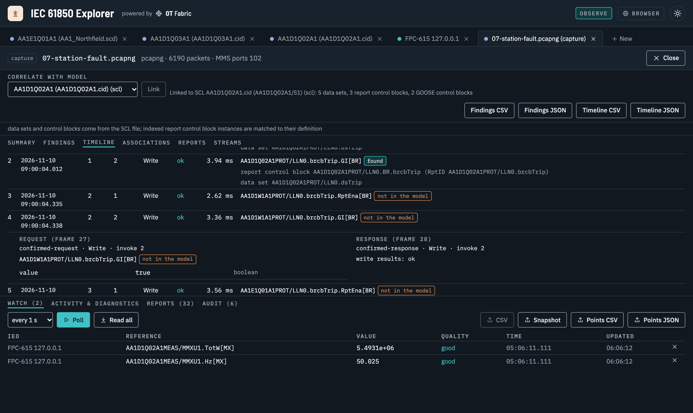

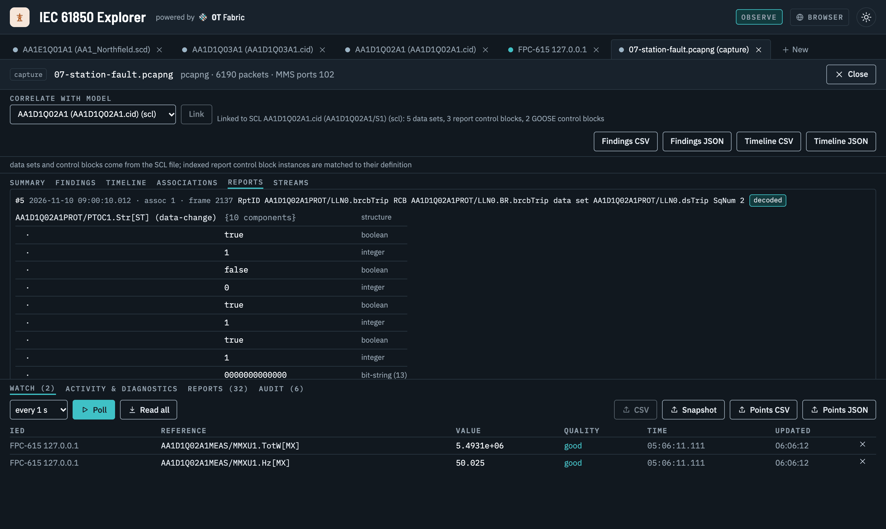

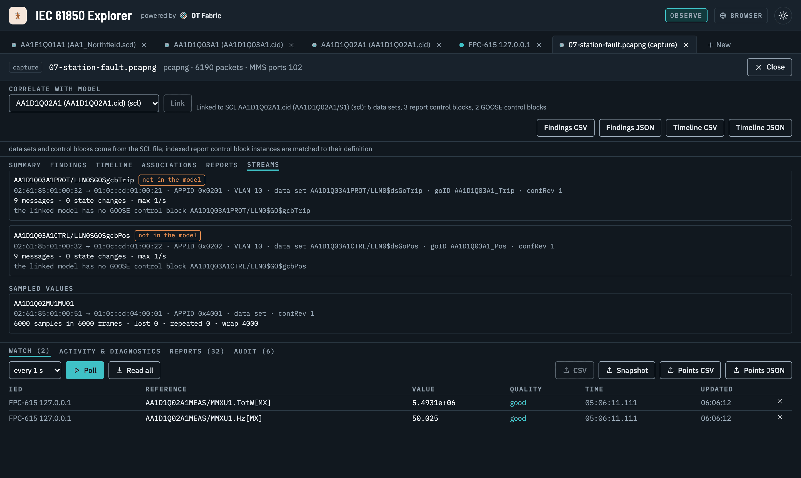

**Pitfalls:**

- A capture links to one IED's model. The busbar and transformer reports in capture 07 are shown as captured with "data set not in the linked model", and their GOOSE streams as `not in the model`: link the trace to `AA1D1W1A1` or `AA1E1Q01A1` (open them from the SCD) to decode those.
- The components of a decoded entry (the `general`, `phsA` ... of a `Str` or `Op`) are listed in order with their types but without their names; read them against the data object's CDC (ACD: general, dirGeneral, phsA, dirPhsA, phsB, ...).
- A trace linked to an SCL session reports the setting group control block (`LLN0$SP$SGCB`) as not in the model: the engine builds no SGCB from SCL.
- MMS over TLS in captures is not analysed yet; MMS on another port than 102 only when the port is named under **MMS ports**.

---

## 7. Find what went wrong in a capture

**Goal:** list the problems in a capture, with where each one is and the counter it comes from: lost TCP segments, unanswered and failed requests, rejects, associations captured midstream or aborted, decoding errors, GOOSE and SV sequence problems.

**You need:** a capture; here `demo/captures/08-problems.pcapng` (a bad morning, each problem deliberate, see `demo/README.md`), linked to feeder 2's CID (`AA1D1Q03A1.cid`, open as in playbook 2).

1. **+ New**, **Open capture…**, `08-problems.pcapng`.
2. **Correlate with model**: `AA1D1Q03A1 (AA1D1Q03A1.cid) (scl)`, **Link**.
3. **findings**: severity, kind, message, where (association, frame, transaction, stream, time) and source, the go-mms-trace field the finding comes from. **Severity** filters them (the list shows the count per severity).
4. Follow a finding to the **timeline** (filter by the association or the time it names) or the **associations** view.
5. **Findings CSV** or **Findings JSON** exports the list, for a report or a ticket; **Timeline CSV** and **Timeline JSON** the timeline.

**You should see:** six errors: a `tcp-gap` in association 2 (a lost segment), two `unanswered` reads, a `tsdu-errors` counter (the malformed request), a GOOSE `sqNum gap` on feeder 2's `gcbPos` and 12 lost SV samples; warnings for the midstream association, the abort, the confirmed error (data set `dsMeas01` that feeder 2 does not have), the orphan reject, the GOOSE publisher restart (`stNum decreased`), the duplicated GOOSE frame, the repeated SV sample, and the objects of the other IEDs that are not in feeder 2's model.

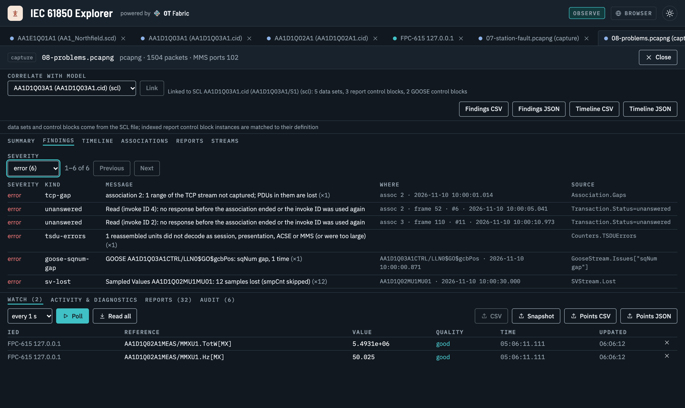

**Pitfalls:**

- A `not-in-model` finding means the object is not in the linked model, not that it is wrong: link the IED that owns it.
- A gap in the capture is not necessarily a gap on the wire: in capture 08 the response the capture lost was delivered (the HMI got it). Findings describe the capture.
- A reject that go-mms answers with invoke ID 0 cannot be paired with its request; it is an `orphan`.

---

## 8. Export a point list for SCADA or gateway engineering

**Goal:** a list of every data attribute of an IED, with what an integrator needs to map it: functional constraint, CDC, type, presence, quantity and unit, and the data sets and report control blocks that carry it.

**You need:** any session: an SCL file (before the IED exists), a snapshot or a live IED.

1. Open the session's tab (here feeder 2's CID).
2. In the **Watch** tab of the dock, choose **Points CSV** (or **Points JSON**). The web UI saves it as a browser download.
3. **CSV** and **Snapshot** next to it export the watched values of the open tab, or the model with its watched values, which opens again later with **Open snapshot…**.

**You should see:** a file such as `iec61850-AA1D1Q03A1-<time>-points.csv`, one row per attribute (453 for feeder 2):

```csv
ref,ld,ln,ln_class,data_object,attribute,fc,cdc,type,presence,quantity,unit,data_sets,reports
AA1D1Q03A1CTRL/CILO2.EnaCls.stVal[ST],AA1D1Q03A1CTRL,CILO2,CILO,EnaCls,stVal,ST,SPS,BOOLEAN,M,,,AA1D1Q03A1CTRL/LLN0.dsPos,AA1D1Q03A1CTRL/LLN0.BR.brcbPos
AA1D1Q03A1MEAS/MMXU1.TotW.db[CF],AA1D1Q03A1MEAS,MMXU1,MMXU,TotW,db,CF,MV,INT32U,O,active-power,,,
AA1D1Q03A1MEAS/MMXU1.TotW.mag.f[MX],AA1D1Q03A1MEAS,MMXU1,MMXU,TotW,mag.f,MX,MV,FLOAT32,O,active-power,W,AA1D1Q03A1MEAS/LLN0.dsMeas,AA1D1Q03A1MEAS/LLN0.RP.urcbMeas
```

**Pitfalls:**

- The point list is the model of the open tab: export it from the SCL to plan, from the IED to document what is really there, and compare the two (playbook 4) when they may differ.
- The quantity and unit come from the namespace; an attribute the namespace gives no quantity for has none in the list.

---

## The light theme

Every view works in both themes; the switch is at the top right.

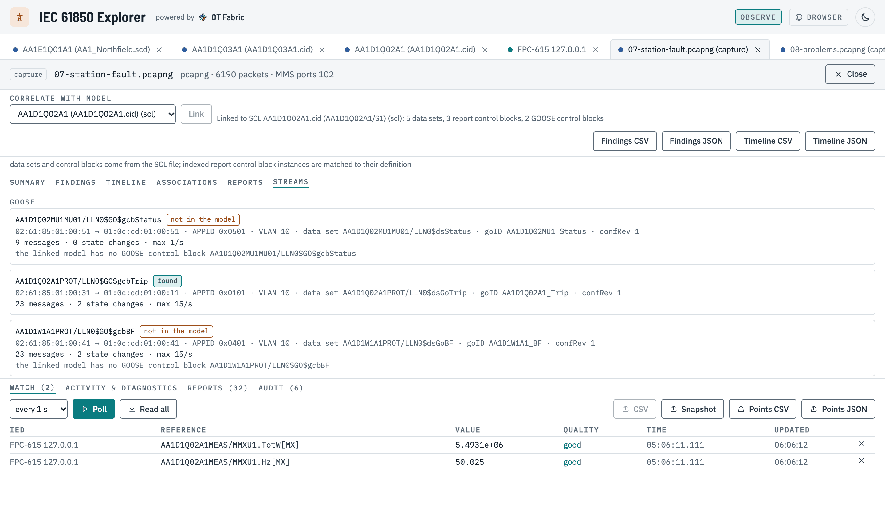

## How these screenshots are made

By [`media/record-demo.mjs`](media/record-demo.mjs), against the daemon and `make demo-ieds` (usage in its header); rerun it when the user interface changes visibly.
